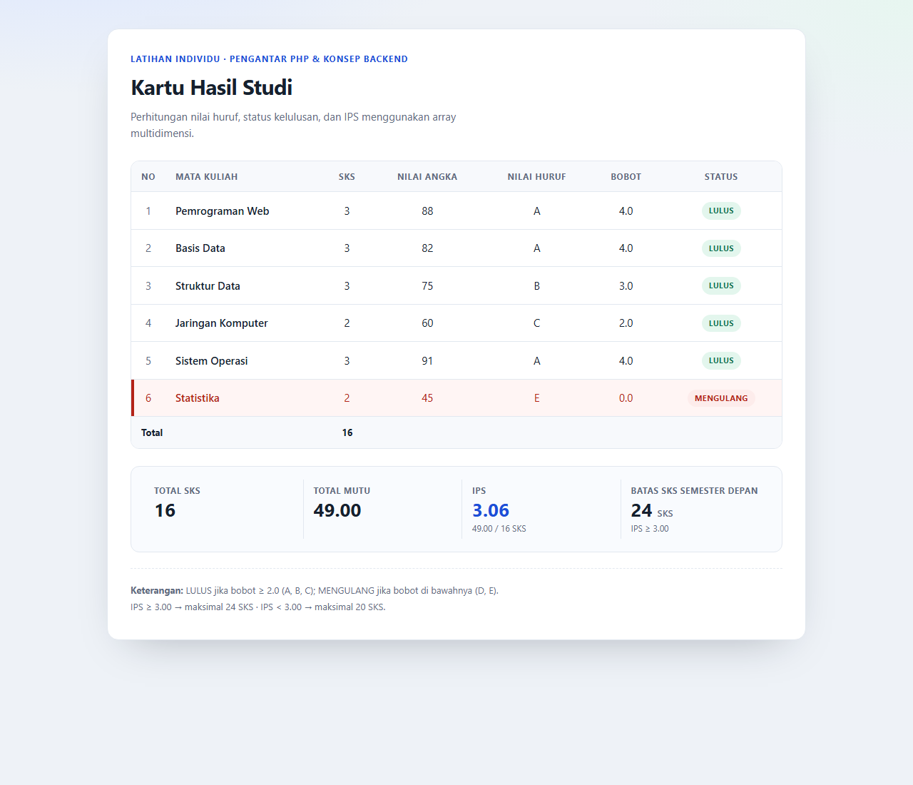

# Latihan Individu — Pengantar PHP & Konsep Backend

Kartu Hasil Studi sederhana berbasis PHP native yang menghitung nilai huruf, status
kelulusan, IPS, dan batas SKS semester depan dari sebuah array multidimensi.

Repo: <https://github.com/AsepBadrusalam/Latihan_Individu_Pengantar_PHP_dan_Konsep_Backend>

## Fitur

- Array multidimensi `$matkul` berisi 6 mata kuliah dengan key `nama`, `sks`, dan `nilai` (0–100).
- Fungsi `hitungBobot($nilai)` mengembalikan huruf mutu dan bobotnya.
- Tabel menampilkan nama matkul, SKS, nilai angka, nilai huruf, bobot, dan status.
- Baris dengan status **MENGULANG** diberi warna merah (latar + teks + aksen kiri).
- Ringkasan IPS: total SKS, total mutu, IPS, dan batas SKS semester depan.
- Batas SKS: IPS ≥ 3.00 → 24 SKS, IPS < 3.00 → 20 SKS.

## Konversi Nilai

| Rentang Nilai | Huruf | Bobot | Status    |
| ------------- | ----- | ----- | --------- |
| 80 – 100      | A     | 4.0   | LULUS     |
| 70 – 79       | B     | 3.0   | LULUS     |
| 60 – 69       | C     | 2.0   | LULUS     |
| 50 – 59       | D     | 1.0   | MENGULANG |
| 0 – 49        | E     | 0.0   | MENGULANG |

Rumus IPS:

```
IPS = total (bobot x SKS) / total SKS
```

## Struktur File

```
.
├── index.php              # Halaman utama (tabel + ringkasan IPS)
├── start.bat              # Jalankan server lokal tanpa setting PATH
├── includes/
│   ├── data.php           # Array $matkul
│   └── functions.php      # hitungBobot(), tentukanStatus(), hitungRingkasan(), e()
├── assets/
│   └── style.css          # Styling tabel, badge, dan ringkasan
├── screenshot.png         # Bukti output di localhost
└── README.md
```

## Cara Menjalankan

PHP **tidak perlu di-download** jika XAMPP atau Laragon sudah terpasang. Skrip
`start.bat` otomatis mencari `php.exe` dari PATH, `C:\xampp\php`, atau
`C:\laragon\bin\php`.

### Opsi 1 — Klik `start.bat` (paling mudah, Windows)

1. Dobel-klik `start.bat` di folder proyek.
2. Browser terbuka otomatis di <http://localhost:8000>.
3. Untuk port lain: `start.bat 8080`.

### Opsi 2 — PHP built-in server manual

```bash
php -S localhost:8000
```

Lalu buka <http://localhost:8000> di browser.

### Opsi 3 — XAMPP

1. Salin folder proyek ke `C:\xampp\htdocs\pemweb`.
2. Jalankan **Apache** dari XAMPP Control Panel.
3. Buka <http://localhost/pemweb>.

### Jika PHP benar-benar belum ada

Install salah satu:

- XAMPP: <https://www.apachefriends.org/download.html>
- PHP for Windows: <https://windows.php.net/download> (pilih **VS16 x64 Thread Safe**,
  ekstrak ke `C:\php`, lalu tambahkan `C:\php` ke PATH)

Setelah itu jalankan `start.bat` lagi.

## Hasil



Data contoh menghasilkan IPS **3.06** dari 16 SKS, sehingga batas SKS semester
depan adalah **24 SKS**, dengan mata kuliah Statistika (nilai 45) berstatus
MENGULANG dan ditandai warna merah.

## Mengubah Data

Edit `includes/data.php`, misalnya:

```php
$matkul = [
    ['nama' => 'Pemrograman Web', 'sks' => 3, 'nilai' => 88],
    // ...
];
```

Huruf mutu, status, IPS, dan batas SKS akan dihitung ulang otomatis.
